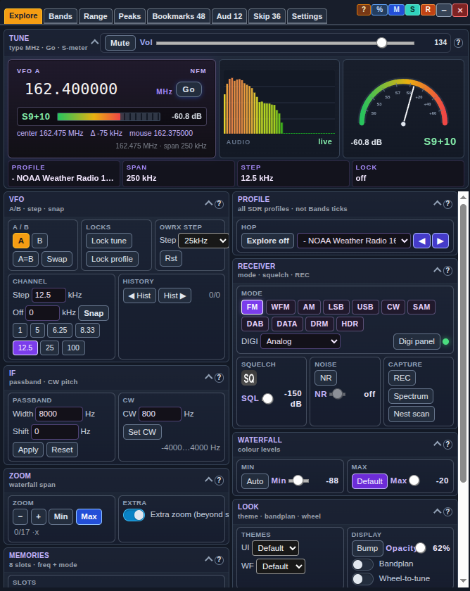
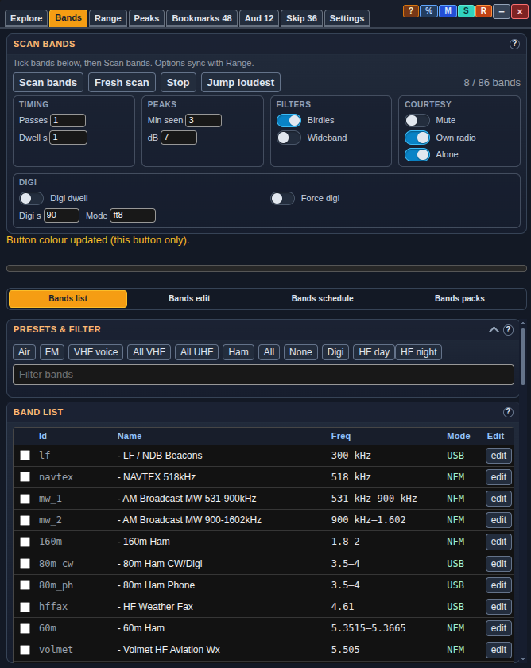
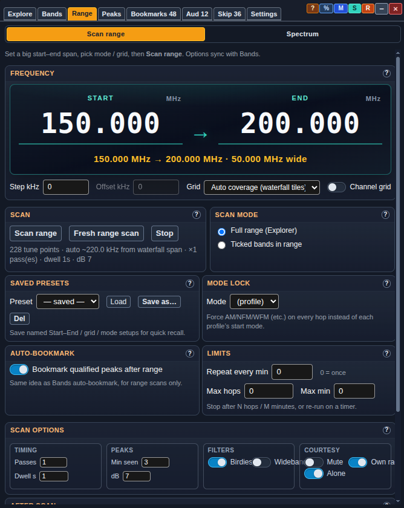
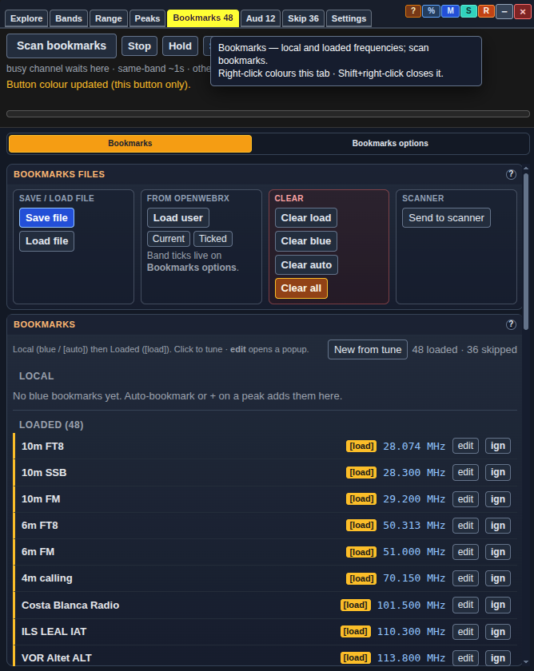
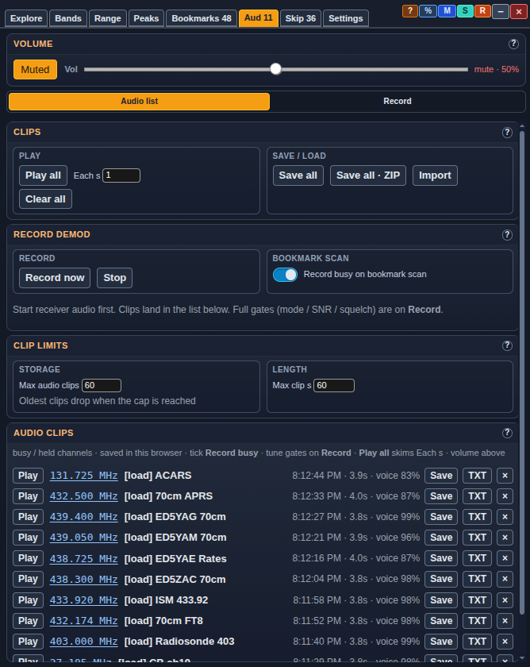
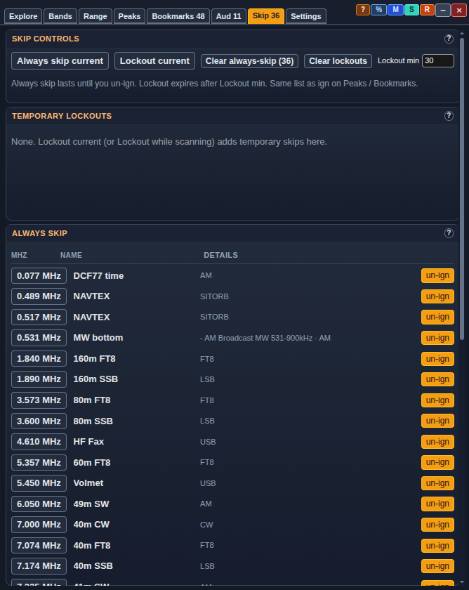
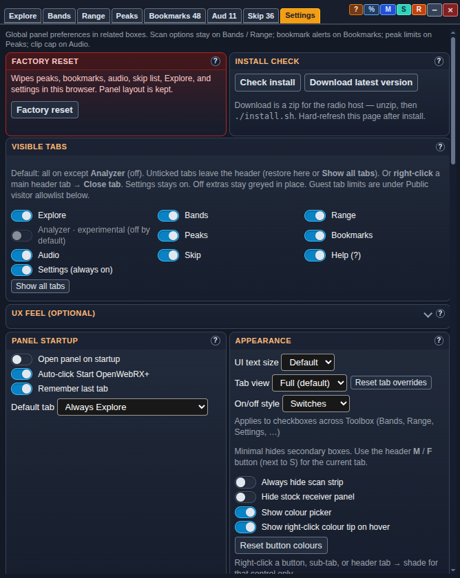
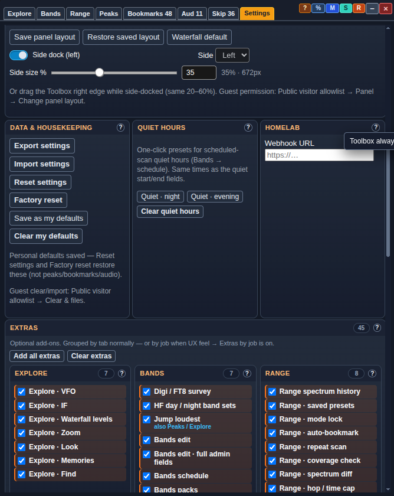
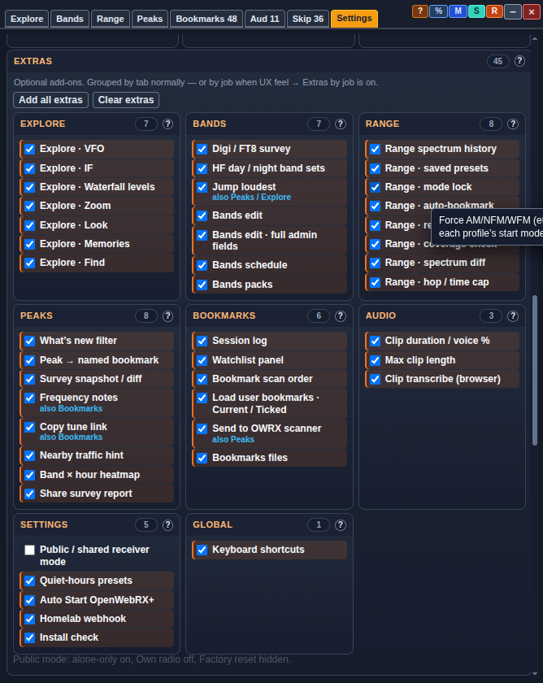
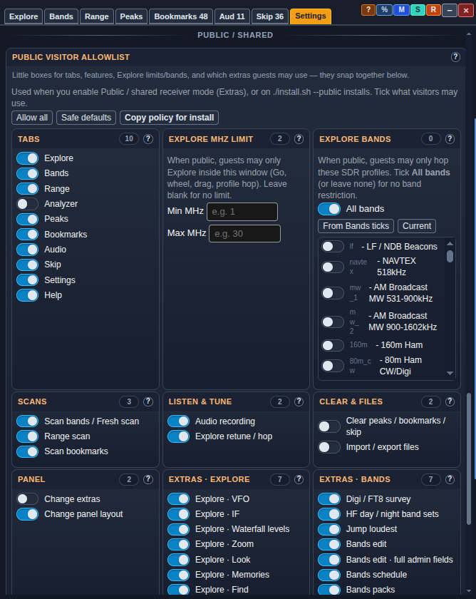

# OpenWebRX Toolbox (vB138)

**OpenWebRX+ receiver plugin** — band / range survey, Explore, Identify, Log,
Watch, peaks, bookmarks, audio clips, DX / sats, and more. Formerly **Band
Survey** (`band_survey`). Plugin id is now `toolbox`.

> **Repo:** [G4EA5/openwebrx-toolbox](https://github.com/G4EA5/openwebrx-toolbox)
> (same repository; display name **OpenWebRX Toolbox**). Older **Band Survey**
> builds remain downloadable — see [Band Survey (legacy)](#band-survey-legacy).

Standalone plugin for **amateur (ham) radio** and lawful hobby SDR — not for
nefarious interception or eavesdropping. Walks the bands you tick (or a custom MHz
range), counts real waterfall peaks, ranks the busiest, and can bookmark them in
**this browser**.

**Works with any SDR OpenWebRX+ supports** (HackRF, RTL-SDR, Airspy, Lime, SDRplay, …) —
the plugin talks to the OpenWebRX+ UI, not to USB hardware. See
[SDR hardware](#sdr-hardware-hackrf-rtl-sdr-airspy-lime--).

### Manual install — there is no installer

There is **no installer** — only a manual edit of `init.js` to install the first time.
You edit **one file** on the radio host: `plugins/receiver/init.js`. Later updates:
Settings → **Update Toolbox** (see [Routine update](#routine-update-already-installed)).

> **Not a shell command.** The `(async () => { … Plugins.load(…) })();` snippet is
> **JavaScript** for `init.js` (or the OpenWebRX browser page). Do **not** paste it
> into bash / a terminal — you will get `syntax error near unexpected token`.
> It also does **not** download files into a folder on disk. The browser loads
> `toolbox.js` (and matching `toolbox.css`) from the CDN when the receiver page opens.

**Easiest (CDN)** — paste this into `plugins/receiver/init.js` on the radio host
(inside the existing `(async () => { … })();`, or use this whole block if the file is empty):

```js
(async () => {
  await Plugins.load("https://cdn.jsdelivr.net/gh/G4EA5/openwebrx-toolbox@main/toolbox.js");
})();
```

Hard-refresh the receiver (**Ctrl+Shift+R** / **Cmd+Shift+R**), click **Toolbox** in
the top bar, then **Settings → Check install**.

**Want the files on disk instead?** Use a terminal (`git clone` or `curl`), not
`Plugins.load` — see [Option B](#option-b--local-copy-from-github) below.

**Local copy** (offline / pin exact files): clone this repo, copy `toolbox.js` +
`toolbox.css` into `htdocs/plugins/receiver/toolbox/`, then
`await Plugins.load("toolbox");` in `init.js`. Full steps → [Install](#install).

**Need v440 specifically?** Use the frozen snapshot in [`v440/`](v440/) (or tag
`toolbox-v440`) — same manual install, different files.

### What’s new since v965 (B era)

After tag **`toolbox-v965`**, versions are **B1**, **B2**, … **B138** (see Help → **What’s new since v965**). Summary:

| Area | Highlights |
| --- | --- |
| **More** | Feeds → Yours, expanded panes (5 default per group), Plan/News/Tips, Calls/prefix data in `toolbox.js` |
| **Explore** | Light boxes, Listen, S-meter calibrate, **SDR only** on Profile hop (B73–B109) |
| **Bands** | Packs per-SDR, **SDR only** bar (with Explore); Beacons/Solar/Today moved to More |
| **Range / Anz / ID** | Per-tab **Choose SDR** (ID: **All SDRs** or one kind); Anz **Main waterfall** on wide spans |
| **Settings** | **Update Toolbox**, multi-SDR block at bottom of **General**, **Public** sub-tab, layout profiles (replaces old Pi preset) |
| **Full guide** | [`docs/WHATS-NEW-SINCE-V965.md`](docs/WHATS-NEW-SINCE-V965.md) · [`CHANGELOG.md`](CHANGELOG.md) |

### What’s new since v440 (high level)

| Area | Highlights |
| --- | --- |
| **Install** | Manual only — edit `init.js` (CDN or local). **No installer** |
| **Explore** | Free-layout boxes; Tune + Listen + light helpers (Clock/QTH, steps, band hop, paste-tune, …); Settings → Explore boxes + **Light features**; Nest scan; Jump loudest |
| **Bands** | Presets + full tick list; beacons / solar / today; edit / schedule / packs |
| **Range** | Jump loudest / choose profile; hop & grid; spectrum chart; scan skips |
| **Identify** | Heuristic signal-type guesses; optional DIY LLM URL Extra (on by default in Visible tabs) |
| **Log / Watch** | Decoder feed, QSO pad, callsign lookup; Watch alerts + Groups + Snooze |
| **More** | Eight groups (Spots…Feeds), up to ten panes each — five on by default; **Settings → General → More sections** |
| **Skip** | Always-skip / lockouts **and** Scan skips (digital bookmarks + block MHz) |
| **Audio** | Clips, record busy, receiver audio filters; optional STT webhook Extra |
| **Public** | **Settings → Public** — shared mode + visitor allowlist (tabs, features, extras, Explore limits, **More panes** per group); optional `TOOLBOX_PUBLIC_POLICY` in host `toolbox.js` |
| **Settings · SDR** | Device switcher, per-kind behaviour profiles, preferred stick by job, Role→SDR, pack pins, network budget, hop settle, storage quotas, key remap, settings sync URL |
| **SDR filters** | **Explore** + **Bands**: shared **SDR only** (All SDRs or one kind). **Range** / **Analyzer**: **Choose SDR** (one radio each). **Identify**: **Choose SDR** with **All SDRs** or one kind — each tab remembers separately |
| **Help** | Hover tips + **?** on every boxed section and sub-tab |
| **Docs** | [Since v965 (B era)](docs/WHATS-NEW-SINCE-V965.md) · [v440→v960](docs/CHANGES-v440-to-v960.md) · [`CHANGELOG.md`](CHANGELOG.md) |

---

## Legal notice — decoding, Identify & audio-to-text

**Intended audience.** OpenWebRX Toolbox is designed for **amateur (ham) radio**
operators and lawful hobby use on your own OpenWebRX+ receiver — surveys,
bookmarks, and station operation. It is **not** intended for surveillance,
unauthorised interception, or other nefarious use.

OpenWebRX Toolbox includes **optional** DIY hooks for **Identify** (external
classifier / **LLM URL**) and **Audio** (voice-to-text / **STT webhook**). They
exist so you can **test your own** HTTP services (Whisper, Ollama, n8n, homelab
scripts, etc.). **Both are off by default** until you enable the matching Extra
and set a URL.

**Your responsibility.** Laws on **monitoring**, **recording**, and **decoding**
radio traffic vary by country and region. In many places it is illegal or
restricted to receive or decode certain services (for example cellular,
encrypted or private communications, or some government / safety / aviation /
maritime bands unless you are authorised). **You** must know and follow the rules
that apply to you, your licence, and your receiver operator. This project does
**not** provide legal advice.

**No liability.** The OpenWebRX Toolbox authors and distributors are **not
responsible** for how you use Identify, decoders, STT, LLM URLs, or recorded
audio. Use these features only on equipment and frequencies you own or have
**explicit permission** to test.

Built-in **Identify** heuristics guess signal *type* from the waterfall; they are
not a callsign or content decoder by themselves. The repo `tools/*-stub.py`
scripts are for **local wiring tests only**, not a supported product backend.
The in-panel **Help** tab repeats this notice next to the LLM and STT boxes.

---

## Where to start

After [install](#install) and a hard-refresh (**Ctrl+Shift+R** / **Cmd+Shift+R**),
open the receiver page and click **Toolbox** in the **top bar** — between **Help**
and **Status** (bar-graph icon). That opens the Toolbox panel. If the top bar is
missing, look for **TB** on the frequency bar (fallback).

<p><em>Click <strong>Toolbox</strong> in the top bar, then Settings → <strong>Check install</strong>.</em></p>

---

## Band Survey (legacy)

This project used to be **Band Survey** only. **OpenWebRX Toolbox** is the current
plugin and includes every Band Survey feature plus much more.

| Want | How |
| --- | --- |
| **Current plugin (recommended)** | [Install](#install) → `Plugins.load("toolbox")` or CDN |
| **Last Band Survey (v127)** | [`legacy/band_survey/`](legacy/band_survey/) |
| **Band Survey v110** | GitHub Release / tag **`band-survey-v110`** |
| **Any older build** | [Releases](https://github.com/G4EA5/openwebrx-toolbox/releases) or `git checkout <tag>` |

**Do not load `band_survey` and `toolbox` together** — they share UI hooks and will
clash. Edit `init.js` so it loads **only Toolbox**.

CDN pin for a specific Band Survey version (use a tag — root `band_survey.js`
only exists on older tags, not on current `main`):

```js
await Plugins.load("https://cdn.jsdelivr.net/gh/G4EA5/openwebrx-toolbox@band-survey-v110/band_survey.js");
/* Last Band Survey on main: */
await Plugins.load("https://cdn.jsdelivr.net/gh/G4EA5/openwebrx-toolbox@main/legacy/band_survey/band_survey.js");
```

---

## Screenshots

<p>
  <strong>Explore</strong> — tune, S-meter, modes, waterfall / IF / zoom<br>
  
</p>
<p>
  <strong>Bands</strong> — scan options, presets, band list<br>
  
</p>
<p>
  <strong>Range</strong> — custom start–end MHz scan<br>
  
</p>
<p>
  <strong>Bookmarks</strong> — local / loaded lists, scan bookmarks<br>
  
</p>
<p>
  <strong>Audio</strong> — clip archive, record busy, volume<br>
  
</p>
<p>
  <strong>Skip</strong> — always-skip list and lockouts<br>
  
</p>
<p>
  <strong>Settings</strong> — visible tabs, appearance, Check install<br>
  
</p>
<p>
  <strong>Settings</strong> — side dock, data, quiet hours, extras<br>
  
</p>
<p>
  <strong>Extras</strong> — optional features grouped by tab<br>
  
</p>
<p>
  <strong>Public visitor allowlist</strong> — shared-receiver guest limits<br>
  
</p>

---

## SDR hardware (HackRF, RTL-SDR, Airspy, Lime, …)

**OpenWebRX Toolbox** is an **OpenWebRX+ browser plugin**. It does **not** open
`/dev/hackrf0`, run `hackrf_sweep`, or talk to Soapy/USB itself.

| Layer | Role |
| --- | --- |
| Your SDR (HackRF, RTL-SDR, …) | Owned by OpenWebRX+ / SoapySDR |
| OpenWebRX+ receiver page | Profiles, waterfall FFT, tune / profile hop |
| Toolbox | Reads waterfall, switches profiles, bookmarks in **this browser** |

**If** OpenWebRX already shows a normal waterfall and an SDR profile list for that
radio, this plugin can survey it — same code path for HackRF, RTL-SDR, Airspy, Lime,
etc.

Practical differences by setup:

- **Profiles must cover the MHz you scan.** Range, Explore, and Analyzer only hop
  where profiles allow.
- **Which SDR’s profiles to list/hop** — **Explore** and **Bands** share **SDR only**
  (All SDRs or e.g. hackrf). **Range** and **Analyzer** use **Choose SDR** (one kind
  each, remembered per tab). **Identify** uses **Choose SDR** with **All SDRs** or one
  kind. Changing HackRF on Range does not change Explore or Anz.
- **Bandwidth comes from OpenWebRX** (`window.bandwidth`).
- **Presets** (Air, FM, …) match common profile id/name patterns. Custom names still
  work — tick bands manually or use **All**.
- **Hardware gain** can be adjusted from Explore → Receiver (see Explore tab guide).
  Needs OpenWebRX Settings admin login. Tested most on RTL-SDR.
- **Analyzer** draws from the live OWRX waterfall (relative dB). It is **not** a
  standalone [HackRF sweep visualizer](https://github.com/G4EA5/hackrf_sweep_visualizer_v1).
- **Identify** guesses signal *type* from waterfall shape and noise (not callsigns).
  Heuristics + Identify Extras (bandplan, digi panel, profile name, stable Live
  vote); optional DIY external classifier Extra. Hide either under Settings →
  **Visible tabs**.
- Vanilla OpenWebRX (no `+`) cannot load plugins.

---

## Raspberry Pi / small PCs

**Yes for a Pi (or similar) as the radio host. Be careful if the browser also runs on that same Pi.**

Toolbox is mostly **browser JavaScript**. The radio host mainly **serves** the plugin files; it does not run most of the UI logic. OpenWebRX+ plus the SDR (demod, waterfall, USB) is what loads a small board — that cost is there with or without Toolbox.

| Setup | Expectation |
| --- | --- |
| **Pi 4 / 5 (or small Linux PC) as OpenWebRX+ server**, browse from a laptop / phone | Usually fine |
| **Pi 3 / Zero 2 (or similar) + Chromium on the device** | Usable; keep Extras lean and avoid heavy features while idle |
| **First load / hard-refresh** | One-time cost: `toolbox.js` is ~1.5&nbsp;MB (~360&nbsp;KB gzipped) — parse is slower on weak SoCs |

**Light (fine on small hardware):** Tune / VFO, bookmarks, band ◀/▶ hop, light Peek / Skip use.

**Heavier (more CPU in the browser tab):** band / range **surveys**, **Identify live**, **Analyzer**, audio FFT scope, **Jump loudest** peak hunting.

**Tips for small PCs / Pi with on-device browser**

- **Settings → General → Choose layout profile** (**Light**) — hides juicier tabs and trims Explore boxes on small PCs. Undo by picking **Everything** or tuning **Visible tabs** / **Explore boxes**. Feedback via [GitHub issues](https://github.com/G4EA5/openwebrx-toolbox/issues) or the [OpenWebRX+ forum](https://groups.io/g/openwebrx).
- Turn off unused **Extras** (Settings) — cuts timers and UI work.
- Untick **Analyzer** / **Identify** under Visible tabs if you do not need them.
- Cap stored peaks (**Max peaks** / untick **Keep peaks between sessions**) if the Peaks tab feels slow.
- Prefer browsing from a normal PC when you run long surveys.

Pi OpenWebRX+ images with Varnish: after file changes, `sudo systemctl restart varnish nginx` (see [Install](#install)).

---

## Install

**There is no installer** for first-time setup — edit `plugins/receiver/init.js` (+ optionally copy two files). Once installed, Settings → **Update Toolbox** can reload a CDN `@main` install or download the latest files for a local copy. You can still clone or pull from [G4EA5/openwebrx-toolbox](https://github.com/G4EA5/openwebrx-toolbox).

### Checklist

1. Confirm you run **OpenWebRX+** (plugins API) — not vanilla OpenWebRX.
2. On the **radio host**, open `plugins/receiver/init.js` (see paths below).
3. Add **one** `Plugins.load(…)` line (CDN **or** local — not both Band Survey and Toolbox).
4. Hard-refresh the receiver (**Ctrl+Shift+R** / **Cmd+Shift+R**).
5. Click **Toolbox** → **Settings** → **Check install** (green = OK).

### What you need

- [OpenWebRX+](https://github.com/luarvique/openwebrx) — the `+` fork with the
  **plugins API** (`plugins.js` / `Plugins.load`). Vanilla OpenWebRX cannot load
  this plugin. You do **not** need a brand-new tip-of-tree build every day — any
  normal OpenWebRX+ with plugins is enough.
- An SDR OpenWebRX+ already drives, with at least one **profile** and a live
  **waterfall**
- SSH / file access to edit `init.js` on the radio host
- A **hard** refresh after install (**Ctrl+Shift+R** / **Cmd+Shift+R**)
- Optional: see [Raspberry Pi / small PCs](#raspberry-pi--small-pcs) if the radio
  (or the browser) runs on a Pi or other small board

### Where is `init.js`?

Under OpenWebRX+ **htdocs** (the folder that contains `openwebrx.js`):

| Typical host | Path |
| --- | --- |
| Debian / Ubuntu package | `/usr/lib/python3/dist-packages/htdocs/plugins/receiver/init.js` |
| Docker | Inside the container at the same relative path (or your bind-mount) |
| Custom / source install | `$HTDOCS/plugins/receiver/init.js` — find with `find / -name openwebrx.js 2>/dev/null` |

If `init.js` is missing, create it. Stock OpenWebRX+ often ships an empty or
minimal async wrapper — keep that shape and add the `Plugins.load` line inside it.

### Option A — CDN (easiest, no file copy)

**This is JavaScript for `init.js`, not a bash download.** Paste it into
`plugins/receiver/init.js` on the radio host. OpenWebRX+ then loads `toolbox.js`
and the matching `toolbox.css` from the same CDN folder in the browser — nothing
is saved under `~/Downloads` or `htdocs`.

```js
(async () => {
  await Plugins.load("https://cdn.jsdelivr.net/gh/G4EA5/openwebrx-toolbox@main/toolbox.js");
})();
```

Pin a release/tag for production instead of floating `@main` when you can (see
[Versions and downloads](#versions-and-downloads)).

Hard-refresh the receiver. Click **Toolbox** → **Settings** → **Check install**.

To **inspect or save** the files yourself (terminal), use Option B or:

```bash
curl -fsSL -O "https://cdn.jsdelivr.net/gh/G4EA5/openwebrx-toolbox@main/toolbox.js"
curl -fsSL -O "https://cdn.jsdelivr.net/gh/G4EA5/openwebrx-toolbox@main/toolbox.css"
```

### Option B — local copy (from GitHub)

Use this for offline hosts, air-gapped radios, or when you want exact files on disk.

1. Clone or pull the repo (on the radio host, or on a PC then copy the two files):

   ```bash
   git clone https://github.com/G4EA5/openwebrx-toolbox.git
   cd openwebrx-toolbox
   ```

2. Find `htdocs` (folder containing `openwebrx.js`). Back up `init.js` and any
   existing `toolbox/` / `band_survey/` folders.

3. Copy **only** the plugin files you need:

   ```bash
   HTDOCS=/usr/lib/python3/dist-packages/htdocs   # adjust if yours differs
   sudo mkdir -p "$HTDOCS/plugins/receiver/toolbox"
   sudo cp -a toolbox.js toolbox.css \
     "$HTDOCS/plugins/receiver/toolbox/"
   # optional: README.md LICENSE for on-host docs
   ```

4. In `init.js` (local id — **not** the CDN URL):

   ```js
   (async () => {
     await Plugins.load("toolbox");
   })();
   ```

5. Hard-refresh the receiver. **Settings → Check install**. Use **Update Toolbox**
   there for later updates (or GitHub repo / clone-pull).

### Routine update (already installed)

**From Settings (easiest):** Toolbox → Settings → **Update Toolbox** (needs OpenWebRX admin login).

| How you installed | What the button does |
| --- | --- |
| **CDN** with `@main` | Checks GitHub, then **reloads** this browser to pick up the newest JS+CSS. Nothing is written onto the radio host. |
| **Local copy** (or a **pinned** CDN tag) | Downloads a zip of the latest `toolbox.js` + `toolbox.css`. Copy those two files onto the host (path below), then hard-refresh. The browser cannot overwrite server files by itself. |

**By hand** (same result as the zip path):

1. Copy **`toolbox.js`** and **`toolbox.css`** into  
   `htdocs/plugins/receiver/toolbox/` on the radio host (same folder as today).
2. Do **not** change `init.js` unless the load line was removed.
3. **Hard-refresh** the receiver page (**Ctrl+Shift+R** / **Cmd+Shift+R**).
4. **Toolbox → Settings → Check install** — green = OK.

On Pi / Varnish images, restart **`varnish`** / **`nginx`** after file changes if
the browser still shows an old version. Pushing to GitHub is safe; the repo keeps
`TOOLBOX_ALLOW_OWNER_OVERRIDE = true` on purpose (personal default). Lock down a
**shared** host by editing that line in the **server copy** of `toolbox.js` — see
[Public vs own radio](#public-vs-own-radio).

### Upgrading from Band Survey (`band_survey`)

Do **not** load both. Remove any `band_survey` / `Plugins.load("band_survey")`
lines from `init.js`, leave only Toolbox (CDN or local), delete or ignore the old
`band_survey/` folder, then hard-refresh.

### After an OpenWebRX+ package upgrade

Package updates can reset `init.js` and wipe a local `toolbox/` folder. Put the
load line back (and re-copy files if you use Option B), then hard-refresh.

### Docker

Install **inside** the OpenWebRX+ container (or bind-mount `plugins/receiver`).
Clone the repo in the container, copy files as in Option B, edit `init.js`,
restart the container if needed, then hard-refresh the browser.

Raspberry Pi images with Varnish (after file changes):

```bash
sudo systemctl restart varnish nginx
```

---

## Quick start

1. Hard-refresh: **Ctrl+Shift+R** / **Cmd+Shift+R**.
2. Click **Toolbox** in the top bar (between **Help** and **Status**).
3. Open **Settings** → **Check install**. Green = ready.
4. Tick bands (or a preset) and press **Scan bands**.
5. Results appear on **Peaks**. Hover any control for a tip.

| You see | Meaning |
| --- | --- |
| **Toolbox** (or **TB** fallback) | Plugin loaded |
| Band checkboxes | Profiles visible |
| **Check install** “looks good” | Ready to survey |
| Red / yellow box | Follow on-screen fix, then Check install again |

---

## Panel layout

Tabs (left → right): **Explore**, **Bands**, **Range**, **Analyzer**, **Identify**,
**Log**, **Watch**, **Peaks**, **Bookmarks**, **Audio**, **Skip**, **More**,
**Settings**. Help is the brown **?** next to **M** in the header (not a strip
tab). Explore opens by default.

Hide tabs under Settings → **General** → **Visible tabs**. **Show all tabs**
restores everything. Settings always stays on and has sub-tabs **General** ·
**More** · **Public** (admin). **Analyzer**, **Identify**, and **More** are on by
default. Under **Settings → General → More sections**, pick which More panes show (grouped like the
More tab bar) — five per group on by default. **Settings → Public** sets guest
allowlist including **More · Spots / Space / …** at the bottom. Log / Watch /
Bookmarks / Audio / Skip / Peaks / Range also have optional Extra sections (on by
default under General).
Any of those that store transferable data have **Export** / **Import** (file or
Shift-click paste), same gate as Peaks CSV/JSON.

**Light switches** (Settings → Extras): mute while scanning, Hold auto-clear,
peak → Identify, Log auto-scroll / Voice chip, Watch quiet-when-focused /
whole-word, compact peaks, auto-skip birdies, hide always-skipped, scannable-only
bookmarks, Record busy auto-tag, clips newest-first, UTC clocks, quieter status,
remember sub-tabs.

**Main tab size** (Settings → Appearance) defaults to **Default** (100%). Panel
scale is separate (tab content only).

**Mouse:** hover = tip; click any section **?** for a short guide; **Shift+click** =
secondary action; **right-click** = colour picker on buttons (when enabled).

**Side dock (default on):** Toolbox column on the **left** (~35% width). Title-bar
**S** toggles dock; **R** hard-refreshes the page.

**Detach / another screen:** Title-bar **D** opens Toolbox in its own window.
Drag that window to another monitor so the receiver stays on one screen and
Toolbox on another. Turn side dock off first if **D** is greyed out; press **D**
again to return it to the receiver page.

**Explore boxes:** free placement — drag a box **title** to move, drag
**corners/edges** to resize (boxes hug content). Tune stays pinned at the top.
Settings → Panel layout → **Reset Explore layout** restores defaults.

---

## Toolbar

| Control | What it does |
| --- | --- |
| **Scan bands** / **Fresh scan** | Walk ticked bands; Fresh clears peaks first |
| **Stop** | Halt band / range / bookmark scan; may auto-bookmark qualified peaks |
| **Scan bookmarks** | Loop local / loaded bookmarks until Stop |
| **Jump loudest** | Strongest peak on **this** waterfall tile (narrow bands — airband, marine, NFM, SSB/CW). FM broadcast (WFM) is off by default — enable under Settings → **Jump tuning · experimental** (or Extras → Jump · FM broadcast). Jump dB / Cluster / Center screen under each Jump button; FM Grid / ±kHz / Detect under that Settings box. |
| **Hold** / **Skip** / **Always skip** / **Lockout** | Bookmark-scan dwell controls |

---

## Tab guide (summary)

Full detail is also in the in-panel **Help** tab (always matches this build).

### Bands

Sub-tabs: **Bands list** (presets + tick list — scroll for every profile) ·
**Beacons** · **Solar** · **Today** · **Bands edit** · **Bands schedule** ·
**Bands packs**. Scan options sit under Scan bands / Fresh / Stop.
**Bands edit** (Extras) can alias, hide, or **Delete** OpenWebRX profiles (admin).
**Scan skips** (block MHz / skip digital bookmarks) live on the **Skip** tab.

### Range

Custom MHz sweep on one pane: Start/End, scan modes (**Full range**, **Ticked
bands**, **Jump loudest**, **Choose profile**), optional **channel grid** presets
(Airband, PMR446, …), scan skips, and a spectrum chart under the scanner after a
run.

**Jump loudest (peaks)** (Range → Scan mode): within Start–End MHz, the scan
**does not** walk fixed steps. It dwells, logs peaks to the **Peaks** tab, then
jumps to the **next loudest** signal in the span (same detect as Explore **Jump
loudest**). When no new peaks appear on the current waterfall tile, it advances
the tile across the range. Turn on **Auto-bookmark** (or Range auto-bookmark
Extra) and set **Min seen** so qualified peaks become blue bookmarks. Not for FM
broadcast (WFM).

### Explore

Browse the whole spectrum; receiver controls (modes, SQL, NR, mute/vol), zoom,
memories, find. Free-layout boxes (drag titles / resize edges). Tune stays pinned
with frequency, audio scope, and analogue S-meter.

**Jump loudest** (Hop box): retune to the strongest other peak on this waterfall
tile. Works on **narrow** bands (airband, marine, NFM, SSB/CW). **Disabled on FM
broadcast (WFM)** — use manual tuning on wide FM. **Jump dB**, **Cluster kHz**, and
**Center screen** sit under the Hop buttons here (FM Grid / ±kHz / Detect are
experimental — Settings only).

**Nest scan** (Explore → Receiver → Capture): a light **channel hopper** for
channelized bands (PMR, airband, marine, etc.). It is **not** **SQL auto** (that
button sets squelch from the S-meter and runs OpenWebRX’s built-in squelch
scanner).

| State | What happens |
| --- | --- |
| **Nest scan** (off) | Click to start. |
| **Nest on** | While squelch is **closed** (S-meter below your SQL slider — green SQL LED off), Toolbox steps the tune **forward one step** on a timer. Step size is your **VFO Channel step** (or **OWRX step** if the LCD step chip is set to OWRX). |
| Signal heard | When squelch **opens**, hopping **pauses** until the channel is quiet again. |
| Stop | Click **Nest on** again. |

Set **Channel step** / offset in the **VFO** box before starting. Only one heavy
radio job runs at a time — turning Nest on may stop an active Bands, Range, or
Bookmark scan (you’ll be asked to confirm).

**Hardware gain** (Explore → Receiver): RF / IF for SDRplay (RSP), overall or
staged gain for HackRF / Airspy / Lime, and a single **tuner** control for RTL-SDR.
The box auto-shows when Toolbox detects your SDR. Default is **Auto** (AGC) when
the profile has no manual value.

Changing gain writes into the active OpenWebRX **profile**. That needs an
**OpenWebRX Settings admin login in the same browser** (receiver page password /
Basic auth is not enough). Open **Settings**, sign in, hard-refresh the receiver,
then use Explore. Guests see a locked preview. Tested most thoroughly on RTL-SDR;
other SDR types use the same path but need real-world feedback.

### Analyzer

Live spectrum from the OWRX waterfall. Hide under Settings → **Visible tabs** if
you do not need it.

### Identify

Guesses signal *type* from waterfall shape and noise (not callsigns). Hide under
Settings → **Visible tabs** if you do not need it.
**Built-in heuristics** score CW / SSB / digi-cluster / NFM / WFM / airband-like /
noise from the FFT near the VFO. Bookmarks at the tune point teach a small
local fingerprint store.

**Identify Extras** (Settings → Extras → Identify, all on by default):

| Extra | Effect |
| --- | --- |
| **Bandplan priors** | Boost from Band-mode allocations + FT8/FT4/JS8/WSPR/APRS dials |
| **Stable Live vote** | Smooth Live Identify across the last few samples |
| **Digi panel hint** | Strong boost if an OWRX digi panel already shows FT8/WSPR/… text |
| **Current mode prior** | Mild boost when a guess matches the demod you are already using |
| **Profile name hint** | Boost from the current SDR profile name (Airband, FT8, Marine, …) |
| **External classifier** | Optional DIY HTTP hook — Identify now only (on by default; untick if unused) |

**LLM URL (optional):** set a URL on the Identify tab → **LLM URL** box (after
the **legal notice**). **Identify now** POSTs JSON and merges guesses; Live
stays local. Nothing is bundled — you run your own service for **your own lawful
testing**. See [Legal notice](#legal-notice--decoding-identify--audio-to-text).

The **Identify LLM URL** and **Audio STT URL** (see below) are **experimental
and untested** — DIY HTTP hooks only. The maintainer is **not responsible** for
your use. Toolbox does not ship bundled speech or classifier backends; use the
`tools/*-stub.py` scripts only to verify wiring on your homelab.

```http
POST /your-url
Content-Type: application/json

{ "frequencyHz": 145500000, "fingerprint": { ... }, "source": "openwebrx-toolbox", "version": 580 }
```

```json
{ "guesses": [{ "id": "nfm", "label": "NFM", "score": 72, "mode": "nfm", "detail": "optional" }] }
```

Classidyne-style `{ "class_scores": [{ "class": "…", "confidence": 80 }] }` is
also accepted. Failures are ignored; heuristics still show.

### Log / Watch / More

**Log** — decoder feed, QSO pad (ADIF export), callsigns with lookup.  
**Watch** — alert when a call / flight / ship / talkgroup appears in a new Log
line; **Groups** arm on↔off; **Snooze**.  
**More** — eight groups (Spots / Space / Tune / Sky / Here / Sked / Read /
Feeds), up to ten panes each (DX, POTA, Sats, Dial, Prop, QTH, Contest, News,
custom RSS, …). Five panes per group on by default (**Settings → General → More sections**). Each
pane only fetches or runs timers while open.

**Feeds → Yours** — add your own RSS/Atom URLs (stored in this browser; same
headline fetch as Read → News). Enable the **Feeds** group under **Settings →
More** if you do not see it.

**Public `TOOLBOX_PUBLIC_POLICY`** — include a `moreSubs` array (pane ids such as
`dx`, `sats`, `news`, `myfeeds`) so guests only open allowed More panes; use
**Settings → Public → Copy policy for install** or see the sample at the top of
`toolbox.js`.

### Peaks / Bookmarks / Audio / Skip

Ranked peaks; local bookmarks + scan; clip archive / record / audio filters;
always-skip, timed lockouts, and **Scan skips** (digital bookmarks + block MHz
stretches, also on Range).

#### Bookmark colours (OpenWebRX waterfall vs Toolbox)

OpenWebRX and Toolbox use different words for the same ideas — easy to mix up:

| On the **OpenWebRX waterfall** | What it is | In **Toolbox Bookmarks** tab |
| --- | --- | --- |
| **Yellow** | Server bookmarks on the radio (`bookmarks.json` / Settings → bookmarks). Shared for all users. | **Load yellow (server bookmarks)** copies them into amber **`[load]`** in *this browser* for **Scan bookmarks**. Toolbox **edit** does **not** change yellow on the server. |
| **Green** (e.g. **WSPR**) | Band-plan dial for the active profile — not in the bookmark file. | **Not loadable.** Tune on the waterfall, or add a yellow/blue bookmark at that MHz if you want scans to visit it. |
| **Blue** | Local bookmarks in *this browser* (receiver + button). | **Local** list — already shown; no load button. |

| In Toolbox only | What it is |
| --- | --- |
| **`[load]`** (amber tag) | A **copy in this browser** for scanning, from **Load yellow** or **Load file**. Editing **`[load]`** does not update the server yellow list. |

**Save file** exports Local + `[load]` from this browser. To change **yellow** bookmarks on the host, use OpenWebRX **Settings → bookmarks** (admin) or merge JSON on the server.

**Audio · STT webhook** (optional, off by default): enable under Settings →
Extras, then set **STT URL** at the bottom of the **Audio** tab (after the
**legal notice**). Toolbox POSTs clip audio (WAV base64) and metadata to your
homelab endpoint; expect JSON `{ "transcript": "…", "summary": "optional" }`.
Same legal and DIY-only stance as the Identify **LLM URL** — see
[Legal notice](#legal-notice--decoding-identify--audio-to-text).

---

## Settings (panel-wide)

| Setting | Default | Description |
| --- | --- | --- |
| **Open panel on startup** | off | Open Toolbox when OpenWebRX loads |
| **Auto-click Start OpenWebRX+** | off | Click the Start overlay on load |
| **Remember last tab** | on | Restore last tab |
| **Default tab** | Always Explore | Tab on open |
| **UI text size** | Default | Small / Default / Large |
| **On/off style** | Switches | Or tick boxes |
| **Tab view** | Full | Or Minimal; header **M**/**F** per tab |
| **Show colour picker** | on | Right-click buttons for shade menu (not header tabs) |
| **Show right-click colour tip** | on | Hover hint mentions right-click colour |
| **Mute when changing tab** | **on** | Mute receiver audio while this browser tab is in the background (stock `owrx_hush` behaviour). Untick to keep listening in other tabs |
| **S-meter calibrate** | — | Align **Toolbox** Explore/Identify meters only (never OpenWebRX’s built-in S-meter). **Pick any SDR** in the dialog (chip chooser) — switches device and loads that stick’s points. Capture at **3–5 frequencies** per SDR; interpolates. **RF damage risk** — attenuator / start weak. Never transmits |
| **Hide stock receiver panel** | off | Use Explore instead of the floating stock panel |
| **Show scan strip** | on | Bands/Bookmarks scan strip when idle (off = hidden until a scan runs) |
| **Side dock** | on, left ~35% | Column layout; **S** in title bar; **%** resets width to 35% |
| **Reset Explore layout** | — | Clear free Explore box positions and sizes |
| **Visible tabs** | Analyzer / Identify / More on | Untick tabs to hide from the header |
| **More sections** | 5/group on | **Settings → General → More sections** — tick extra panes; **Show all More sections** |
| **Main tab size** | Default (100%) | Header tab bar only (Appearance) |
| **UX feel** | all off | Optional soft overlays |
| **Settings sub-tabs** | General | **More** = your More panes; **Public** = shared mode + guest allowlist |
| **Public / shared receiver** | off | **Settings → Public** (admin) |
| **Public visitor allowlist** | safe defaults | Guest tabs, features, extras, Explore limits; **More** panes at bottom of Public |
| **More sections (yours)** | top 5/group | **Settings → General → More sections** — not the same as Public More boxes |
| **Save as my defaults** | — | Personal defaults for Reset / Factory reset |
| **Check install** | — | Verify plugin + receiver |
| **Webhook URL** | blank | Optional POST on each new peak |
| **Quiet-hours presets** | — | Extra: night / evening / clear for scheduled scans |

Scan options live on **Bands** / **Range**; bookmark options on **Bookmarks**; peak
limits on **Peaks**; clip caps on **Audio**.

---

## Scan behaviour

- **Band / range:** same-band hops ~1 s; other-band ~11 s (or ~1 s with **Own radio —
  fast hops** on a receiver you run).
- **Bookmark scan:** continuous loop, or pause-on-busy with Continue / Skip / Hold.
- **Recording:** **Record busy** while parked on a bookmark; **Record now** for a
  manual clip. Not during band/range walks.

---

## Persistence

| Data | Storage |
| --- | --- |
| Settings, peaks, skip list, panel layout | **localStorage** |
| Audio clips | **IndexedDB** |
| Blue bookmarks (waterfall + Toolbox **Local**) | OpenWebRX **local** bookmark store in this browser |
| Amber **`[load]`** rows | Toolbox **`localStorage`** only (scan copy; see table above) |
| Yellow server bookmarks | On the **radio host** — not replaced by Toolbox clear/load |

Nothing is uploaded except optional **Webhook URL** POSTs.

---

## Public vs own radio

Three **separate** ways to turn on “public” behaviour. They are **not** the same
button — especially the Settings tick vs editing `toolbox.js`.

| Mechanism | Where | Who it affects |
| --- | --- | --- |
| **Toolbox tick** | Toolbox → **Settings** → **Public / shared receiver** (log into OpenWebRX admin first) | Mostly **this admin browser** until you also lock the host file; good for trying guest mode |
| **Hard lock (recommended for strangers)** | Top of **`toolbox.js` on the radio host** — `TOOLBOX_ALLOW_OWNER_OVERRIDE = false` | **Every** visitor loading that file; guests cannot widen limits via Settings or `localStorage` |
| **OpenWebRX General** (some builds only) | **Settings → General → Toolbox: public / shared receiver mode** | All visitors when your build has that row |
| **Optional server flag** | `"toolbox_public_mode": true` in `/var/lib/openwebrx/settings.json` | All visitors when writable (same idea as General) |

**Important:** ticking **Public / shared receiver** in Toolbox **does not** change
`toolbox.js` on the server. GitHub ships `TOOLBOX_ALLOW_OWNER_OVERRIDE = true` on
purpose — safe to publish. For an internet-facing URL, edit the **server copy** of
`toolbox.js` after you copy files from GitHub.

Stock OpenWebRX+ usually **does not** show General → Toolbox public. That is normal;
use the Toolbox box above **Public visitor allowlist**, or the hard lock below.

### Personal / home radio

- Copy **`toolbox.js`** + **`toolbox.css`**, hard-refresh, **Check install** — done.
- Leave `TOOLBOX_ALLOW_OWNER_OVERRIDE = true` (repo default).
- Leave **Public / shared receiver** unticked unless you are testing guest behaviour.

### Shared receiver on the internet (recommended)

After a **local copy** (Option B), edit **`toolbox.js` on the radio host** (not
only the GitHub clone on your laptop):

```js
var TOOLBOX_ALLOW_OWNER_OVERRIDE = false;
```

That applies a **safe visitor allowlist** to every browser (scans on; clear /
import / layout changes off by default). **Own radio — fast hops** and **Factory
reset** stay locked for guests.

To **customize** what visitors may do: log in as admin → Toolbox → Settings →
**Public visitor allowlist** → adjust → **Copy policy for install** → paste as
`TOOLBOX_PUBLIC_POLICY` near the top of host `toolbox.js` → hard-refresh.

Optional: set `"toolbox_public_mode": true` in `settings.json` when that file is
writable (same “all visitors” idea as General).

### Soft public (Toolbox tick only)

Use this to **preview** guest limits while logged in as OpenWebRX admin:

1. Log into OpenWebRX **Settings** (admin password) in the same browser.
2. Toolbox → **Settings** → **Public / shared receiver** → tick **Public / shared receiver mode**.
3. Tune **Public visitor allowlist** below; hard-refresh if needed.

Visitors on other browsers are **not** fully locked until you set
`TOOLBOX_ALLOW_OWNER_OVERRIDE = false` in the **server** `toolbox.js`. Prefer the
hard lock for anonymous URLs.

### Quick reference

| Want | Do this |
| --- | --- |
| **Update plugin only** | Settings → **Update Toolbox**, or copy `toolbox.js` + `toolbox.css` → hard-refresh → Check install |
| **Personal / trusted LAN** | Repo default (`override = true`); Public tick optional |
| **Public URL, strangers** | `TOOLBOX_ALLOW_OWNER_OVERRIDE = false` in **host** `toolbox.js` |
| **Custom guest limits (server-wide)** | Allowlist → **Copy policy for install** → `TOOLBOX_PUBLIC_POLICY` in host file |
| **General checkbox visible** | That server switch wins; Toolbox tick follows it read-only |

### Summary

- **Personal:** Own radio / fast hops available unless public mode is on.
- **Hard public:** `TOOLBOX_ALLOW_OWNER_OVERRIDE = false` on the host — same safe
  rules for every browser; strongest for shared sites.
- **Toolbox tick:** Admin convenience; does **not** replace the host-file edit for
  strangers.

---

## Troubleshooting

| Problem | Fix |
| --- | --- |
| No **Toolbox** button | Hard-refresh; confirm `Plugins.load` in `init.js`; Settings → **Check install** |
| **Band Survey and Toolbox both loaded** | Edit `init.js` to load only `toolbox` (remove `band_survey`) |
| Audio stays muted after leaving the tab | Update to v403+ (mute restore) / v405 docs; Settings → **Mute when changing tab** (on = mute in background, restores on return) |
| Explore boxes empty on the right after **%** / side resize | Hard-refresh to **v405+**; Explore re-packs after side width settles |
| Explore boxes overlap / blank band under Tune | Hard-refresh to **v955+**; Settings → **Reset Explore layout**. Drag box titles / edges (free layout) |
| Check install yellow/red | Follow the on-screen fix; Help → **Copy diagnostic report** |
| No **Toolbox: public** in Settings → General | Normal on stock OpenWebRX+. Use Toolbox → **Public / shared receiver** while OpenWebRX-admin, or hard-lock host `toolbox.js` |
| **WebSocket has closed unexpectedly** / reconnect countdown | **OpenWebRX** lost the live link (server restart, network, proxy timeout, tab sleep, SDR backend). **Not caused by Toolbox file updates alone.** Wait to reconnect, hard-refresh, check host logs. See [docs/troubleshooting.md](docs/troubleshooting.md#websocket-closed--attempting-to-reconnect) |

More detail: in-panel **Help** and [docs/troubleshooting.md](docs/troubleshooting.md). Updates: [GitHub](https://github.com/G4EA5/openwebrx-toolbox).

---

## Versions and downloads

Yes — older builds stay downloadable forever via **GitHub Releases** and **git tags**.
Each publish gets a tag (e.g. `toolbox-v405`, `band-survey-v110`). When Toolbox reaches
v500, **v405** is still on the Releases page and via jsDelivr pinned to that tag.

| Want | How |
| --- | --- |
| **Latest Toolbox** | Clone `main`, or [Releases](https://github.com/G4EA5/openwebrx-toolbox/releases) → newest **Toolbox** |
| **Current B build (e.g. vB138)** | Tag [`toolbox-vB138`](https://github.com/G4EA5/openwebrx-toolbox/releases/tag/toolbox-vB138) or `main` |
| **Last numeric (v965)** | Tag [`toolbox-v965`](https://github.com/G4EA5/openwebrx-toolbox/releases/tag/toolbox-v965) — **B era** starts at **B1** after this |
| **Toolbox v440 (frozen folder)** | [`v440/`](v440/) on `main` — same build as tag [`toolbox-v440`](https://github.com/G4EA5/openwebrx-toolbox/releases/tag/toolbox-v440) |
| **Band Survey v127** (last) | [`legacy/band_survey/`](legacy/band_survey/) on `main`, or tag `band-survey-v127` |
| **Band Survey v110** | Tag [`band-survey-v110`](https://github.com/G4EA5/openwebrx-toolbox/releases/tag/band-survey-v110) |
| **Any older commit** | Releases page, or `git checkout <tag>` |
| **What changed since v965** | [`docs/WHATS-NEW-SINCE-V965.md`](docs/WHATS-NEW-SINCE-V965.md) · [`CHANGELOG.md`](CHANGELOG.md) |
| **What changed since v440** | [`docs/CHANGES-v440-to-v960.md`](docs/CHANGES-v440-to-v960.md) · [`CHANGELOG.md`](CHANGELOG.md) |

**CDN pin (do not use floating `@main` for production):**

```js
/* Toolbox vB21 (after the release tag is pushed) */
await Plugins.load("https://cdn.jsdelivr.net/gh/G4EA5/openwebrx-toolbox@toolbox-vB21/toolbox.js");

/* Last numeric era build */
await Plugins.load("https://cdn.jsdelivr.net/gh/G4EA5/openwebrx-toolbox@toolbox-v965/toolbox.js");

/* Toolbox v440 — folder on main (same build as tag toolbox-v440) */
await Plugins.load("https://cdn.jsdelivr.net/gh/G4EA5/openwebrx-toolbox@main/v440/toolbox.js");

/* Same v440 via release tag */
await Plugins.load("https://cdn.jsdelivr.net/gh/G4EA5/openwebrx-toolbox@toolbox-v440/toolbox.js");

/* Band Survey v110 (tag — root path) */
await Plugins.load("https://cdn.jsdelivr.net/gh/G4EA5/openwebrx-toolbox@band-survey-v110/band_survey.js");

/* Last Band Survey v127 on main */
await Plugins.load("https://cdn.jsdelivr.net/gh/G4EA5/openwebrx-toolbox@main/legacy/band_survey/band_survey.js");
```

| Line | Plugin id | Where |
| --- | --- | --- |
| **Current** | `toolbox` | `toolbox.js` / `toolbox.css` on `main` (**vB21**) |
| **Last Band Survey** | `band_survey` | [`legacy/band_survey/`](legacy/band_survey/) (**v127**) |
| **Older builds** | either | [GitHub Releases](https://github.com/G4EA5/openwebrx-toolbox/releases) / tags |

---

## License

MIT — see [LICENSE](LICENSE).

---

## Links

- Source: https://github.com/G4EA5/openwebrx-toolbox
- OpenWebRX+: https://github.com/luarvique/openwebrx
- Related: [HackRF sweep visualizer](https://github.com/G4EA5/hackrf_sweep_visualizer_v1) (separate project)
